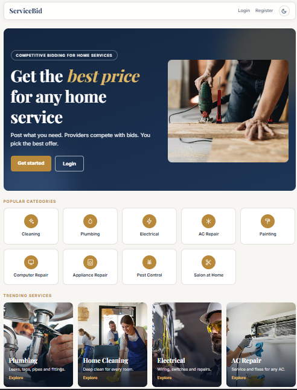
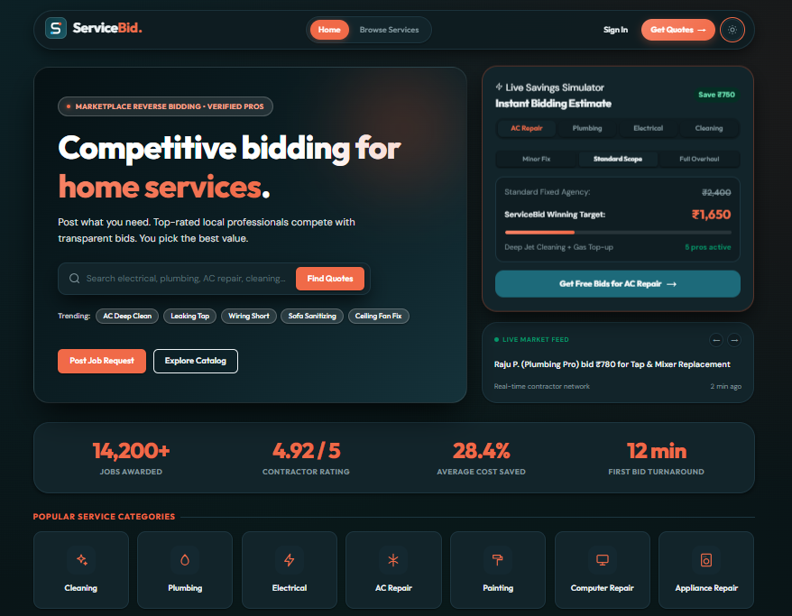
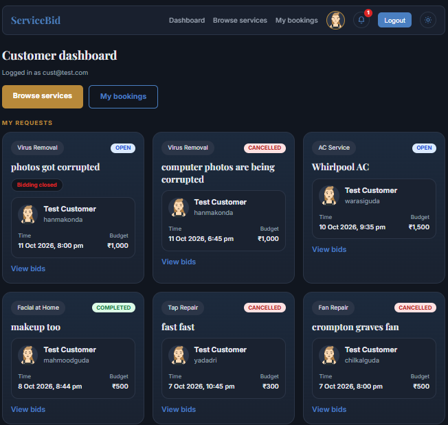
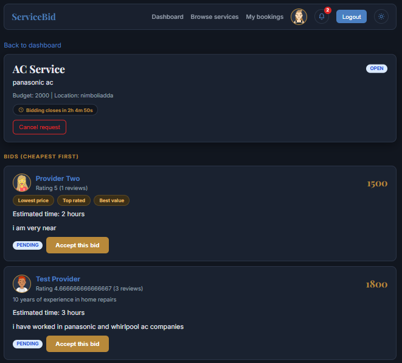
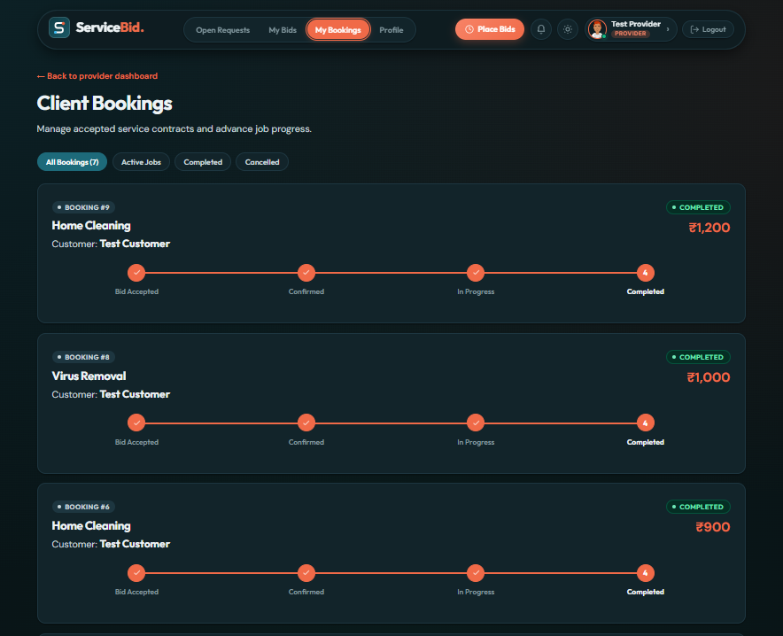
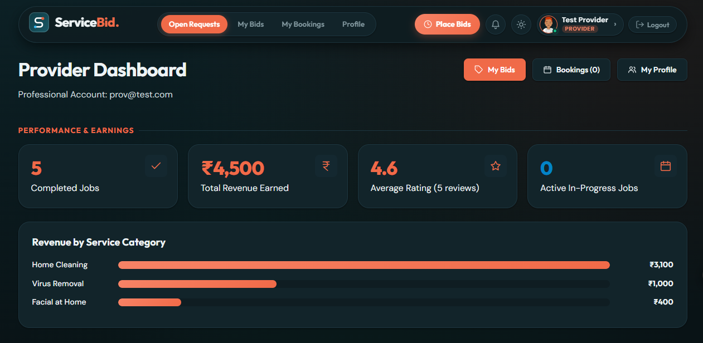
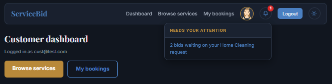
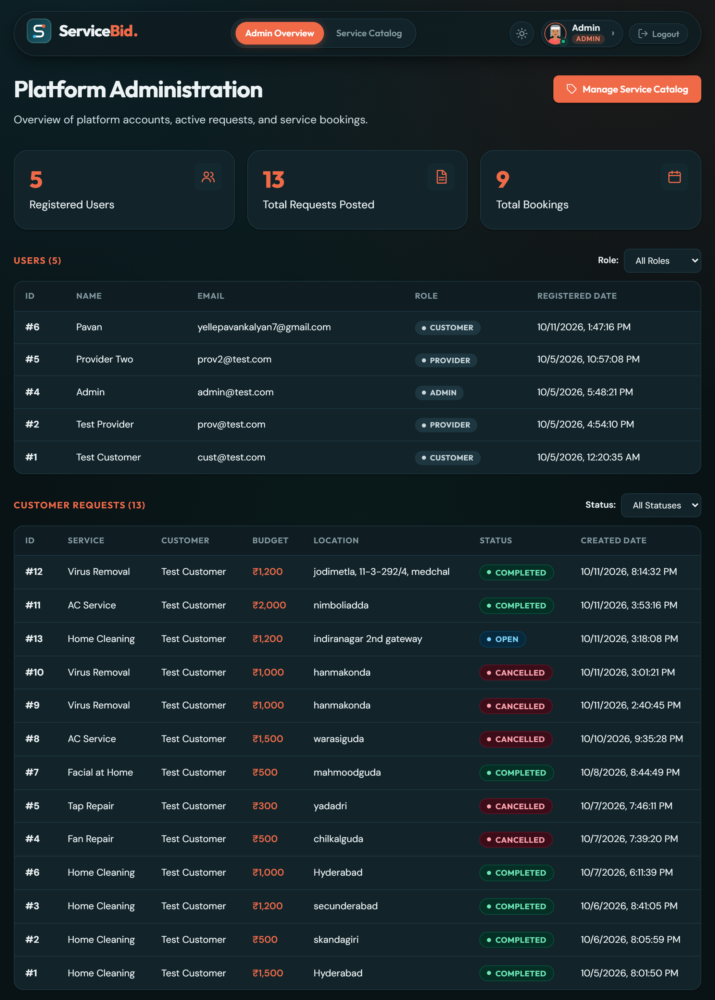
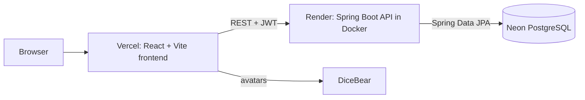
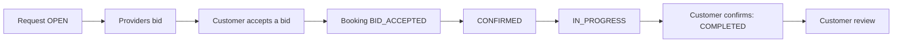

# ServiceBid

A service marketplace with competitive bidding. Customers post a request, providers compete with bids, and the customer accepts the best offer, tracks the job and leaves a review.

**Live demo**
- Frontend: https://service-bid.vercel.app
- Backend API: https://servicebid-ynj4.onrender.com

The backend runs on a free Render instance that sleeps when idle. The first request after a pause can take about a minute.

## Screenshots

| | |
|---|---|
|  |  |
|  |  |
|  |  |
|  |  |

## Demo accounts (password: secret123)

| Role | Email |
|------|-------|
| Customer | cust@test.com |
| Provider | prov@test.com |
| Provider | prov2@test.com |
| Admin | admin@test.com |

## Features

**Customer**
- Home page with a live savings simulator, rotating bids ticker, trending services, verified provider spotlight, customer reviews and an FAQ
- Browse 19 services in 9 categories, with search, category chips, sorting, saved favourites (heart) and a recently viewed strip
- Post a request with description, budget, date, location and an optional bid deadline (live countdown)
- Compare bids side by side, with smart tags (Lowest price, Top rated, Best value)
- Accept a bid, which creates a booking
- Cancel an open request (pending bids are rejected)
- Track the booking with a progress timeline
- Confirm the job is done, then leave a star review
- Cancel a booking before work starts
- View a provider's public profile and reviews
- Invoice for completed bookings (print or save as PDF)
- Notification bell: bids waiting, jobs to confirm

**Provider**
- Choose the services they offer, and write a bio
- See only open requests that match their services
- Place bids before the deadline, and withdraw a pending bid
- Manage bookings (Confirmed, In progress)
- Dashboard with completed jobs, total earned, average rating and an earnings chart
- Notification bell: new matching requests, accepted bids

**Admin**
- Overview of all users, requests and bookings
- Manage the catalog: add, rename and delete categories and services

**General**
- JWT login with roles (Customer, Provider, Admin)
- Dark mode with a circular transition, toast messages, empty states, loading skeletons
- Animations: count-up numbers, scroll reveal, hover effects
- New brand identity: custom logo, favicon, floating navbar, footer
- 404 page and back-to-top button
- Responsive layout for mobile

## Architecture



**Backend layers:** controller (REST endpoints) -> service (rules and validation) -> repository (database) -> model (entities). A JWT filter in the security layer checks the token and the role on every request.

**Booking flow**



## Tech stack

- Frontend: React, Vite, React Router, plain CSS, react-hot-toast, Google Fonts (Outfit and DM Sans)
- Backend: Java 21, Spring Boot, Spring Security, Spring Data JPA, JWT (jjwt)
- Database: PostgreSQL on Neon
- Hosting (all free tiers): Vercel (frontend), Render with Docker (backend), Neon (database)
- Avatars: DiceBear (https://www.dicebear.com), free cartoon faces generated from a name

## Run locally

Backend (folder `backend`), with these environment variables set: `DB_HOST`, `DB_NAME`, `DB_USER`, `DB_PASSWORD`, `JWT_SECRET` (40+ characters). Then run `BackendApplication`. It starts on port 8080.

Frontend (folder `frontend`):

```
npm install
npm run dev
```

It opens on http://localhost:5173.

## Future improvements

- Online payments
- In-app chat between customer and provider
- Maps and distance to the job location
- Image uploads for requests and provider profiles
- Real stored notifications with a "mark as read" option
- Sidebar layout for dashboards